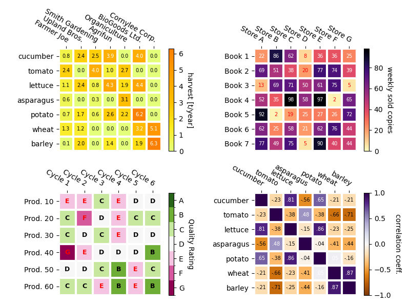
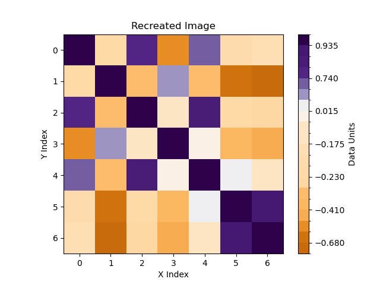
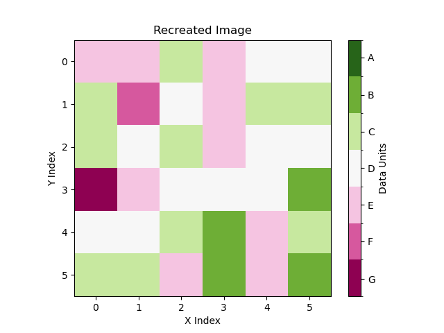

# Digitize Gridded Data in Images

This code analyzes the color values in an image and, using a colormap, converts them
back to data space.
The use case is analogous to plot digitizers that convert data from graphs or maps back
into data space - here, we work with colors instead.

## Prerequisites

Install the packages from `requirements.txt`, e.g. into a new conda environment like this:

    conda env create -n digitize -f requirements.txt

## Usage

`digitize_gridded_image.py` is a standalone script. Call it without any arguments to
display the usage message:

    > python digitize_gridded_image.py

    usage: digitize_gridded_image.py [-h] [--recreate-image RECREATE_IMAGE] [--ignore-black IGNORE_BLACK] filename data_box legend_box markers_pixel markers_data nx ny output_name

    Extract data from an image and colorbar.

    positional arguments:
      filename              Filename of image.
      data_box              JSON-formatted string of (inclusive) pixel boundary coordinates of the data in the order [left, top, right, bottom].
      legend_box            JSON-formatted string of (inclusive) pixel boundary coordinates of the colorbar in the order [left, top, right, bottom]; note that either left=right or     top=bottom.
      markers_pixel         JSON-formatted string of ascending pixel coordinates of the tick labels (x coordinates if colorbar horzontal, y otherwise).
      markers_data          JSON-formatted string of data values of the tick labels.
      nx                    Number of data grid points in the x direction.
      ny                    Number of data grid points in the y direction (defaults to `nx`).
      output_name           Output filename for data with either `.npy` or `.txt` extension.

    options:
      -h, --help            show this help message and exit
      --recreate-image RECREATE_IMAGE
                            If provided, also save a debugging image with the extracted colors to the specified filename.
      --ignore-black IGNORE_BLACK
                            When extracting the dominant colors, ignore pixels this far away in RGB space from true black using Euclidean 3D distances.
      --nan-colors RGB        JSON-formatted string of an [r, g, b] color that stands for missing data; may be given multiple times.
      --nan-colors-tol NAN_COLORS_TOL
                            Distance in RGB space up to which the dominant color of a cell counts as being one of the --nan-colors (default 5).

## Example

Suppose you want to get the data from a plot like the bottom right one one in this [Matplotlib
example](https://matplotlib.org/3.8.2/gallery/images_contours_and_fields/image_annotated_heatmap.html),
section *Some more complex heatmap examples*.
We want to analyze each colored patch on the grid and then use the provided colormap to estimate what
value was used to generate the color for the patch.
Running the example script and saving the last plot as a file gives this figure:

We then need the pixel coordinates for the data and the colorbar, which we can get e.g. using Matplotlib:

    python -c "import matplotlib.pyplot as plt; from PIL import Image; plt.imshow(Image.open('image_in.png')); plt.show()"

Zooming in and out and moving the mouse coordinates we find the following:

- The bounding box for the data is `[left=498, top=379, right=693, bottom=574]`.
- One line on the the colorbar is `[715, 377, 715, 577]`.
- The markers on the colorbar are at the y pixel coordinates `[377, 427, 477, 527, 577]`.
- The markers on the colorbar represent the values `[1, 0.5, 0, -0.5, -1]`.
- We count `nx=7` and `ny=7` patches in the x and y directions, respectively.

With that, we have all we need to run the script:

    python digitize_gridded_image.py image_in.png "[498, 379, 693, 574]" "[715, 377, 715, 577]" "[377, 427, 477, 527, 577]" "[1, 0.5, 0, -0.5, -1]" 7 7 data_out.txt --recreate-image=image_out.png

Which yields the following recreated image:

Which looks pretty much exactly like the input file. The colorbar has a different progression, but that's because it's based only on recognized colors
and doesn't include any assumptions about the linearity of the input colormap.

The data values we get (in `data_out.txt`) are:

|     |      |      |      |      |      |      |
|-----|------|------|------|------|------|------|
| 0.99| -0.22|  0.82| -0.55|  0.66| -0.21| -0.2 |
|-0.22|  0.99| -0.37|  0.49| -0.37| -0.66| -0.7 |
| 0.82| -0.37|  0.99| -0.14|  0.86| -0.22| -0.24|
|-0.55|  0.49| -0.14|  0.99| -0.04| -0.39| -0.43|
| 0.66| -0.37|  0.86| -0.04|  0.99|  0.07| -0.15|
|-0.21| -0.66| -0.22| -0.39|  0.07|  0.99|  0.88|
|-0.2 | -0.7 | -0.24| -0.43| -0.15|  0.88|  0.99|

which are pretty close to the true values (which are kindly included in the Matplotlib
example figure).

This also works for categorical data, e.g.:

    python digitize_gridded_image.py image_in.png "[117, 379, 313, 574]" "[335, 377, 335, 577]" "[390, 419, 448, 477, 506, 535, 564]" '["A", "B", "C", "D", "E", "F", "G"]' 6 6 data_out_cat.txt --recreate-image=image_out_cat.png

Yielding the data

|   |   |   |   |   |   |
|---|---|---|---|---|---|
| E | E | C | E | D | D |
| C | F | D | E | C | C |
| C | D | C | E | D | D |
| G | E | D | D | D | B |
| D | D | C | B | E | C |
| C | C | E | B | E | B |

and the image

Finally, the option `--ignore-blacks` is present for cases where the colored grid data is overlain
by other elements like lines or text that make it harder for the algorithm to extract the dominant
color. Those elements are often in shades of black / dark grey and can be ignored from the
estimation. This however only works if the colorbar itself doesn't include dark colors.

If the plot marks missing data with a fixed color rather than leaving it out - typically the white
of the background or the black of a cell border - those cells can be turned into missing values
with `--nan-colors`, which takes an `[r, g, b]` color and may be repeated for several colors. The
data value of every cell whose dominant color equals such a color (within the distance given by
`--nan-colors-tol`, defaulting to 5) becomes NaN; for categorical data, the missing cells are
written as the empty string. For example, to extract the data of a plot whose missing data is
marked in white and black:

    python digitize_gridded_image.py image_in.png "[498, 379, 693, 574]" "[715, 377, 715, 577]" "[377, 427, 477, 527, 577]" "[1, 0.5, 0, -0.5, -1]" 7 7 data_out.txt --nan-colors="[255, 255, 255]" --nan-colors="[0, 0, 0]"

## Multi-panel figures

A figure made of many small panels - a grid of heatmap or map subplots whose
rows share a colorbar each - is handled by a pipeline of four scripts. The
first three measure the geometry of the figure (where its panels are, and
where the cells inside them are separated), and the last one digitizes every
panel with the color logic of `digitize_gridded_image.py` and stacks the
results into one array. Each script takes one step and prints what it found;
the first and last can also draw a debug picture to verify the result by eye.
Below, `figure.png` stands for the image of your figure.

### 1. Locate the panels: `panel_lattice.py`

    python panel_lattice.py figure.png n_rows n_cols x y width height [--overlay]

The four numbers `x y width height` are an inclusive reference box inside the
top-left panel - a region whose picture cross-correlates cleanly against the
other panels, e.g. a data disk rather than a white corner. The script finds
every panel by cross-correlation, derives the panel windows from the white
gutters between them, and writes `figure_lattice.json` (with `--overlay`, also
an image showing the windows for verification). The lattice file records the
panel anchors, the column window positions and widths, and the geometry the
scripts below add to it.

### 2. Measure the cell size: `cell_fft.py`

    python cell_fft.py figure_lattice.json

The cells (the colored patches inside a panel) all share a pixel width and
height, and their thin antialiased seams show up as a peak in the Fourier
spectrum of the panels' brightness differences. Stacking the spectra of all
panels makes the shared cell period stand out against the structure of the
individual panels. The script reports the sub-pixel cell width and height and
stores them in the lattice file as `cell_size_px`.

### 3. Fit the cell grid: `cell_grid.py`

    python cell_grid.py figure_lattice.json [--overlay]

With the shared cell size known, only the alignment of the seams inside each
panel is open. A seam is an antialiased boundary where the colors of the two
sides differ, so the script probes sub-pixel shifts of the seam lattice and
picks the shift whose seam lines show the mean color jump; it stores the
integer seam positions of every panel in the lattice file, together with
diagnostics on how confidently each phase is supported (`--overlay` draws the
fitted grid for verification).

### 4. Digitize: `digitize_multi_image.py`

    usage: digitize_multi_image.py [-h] [--save-panels DIRECTORY]
                                   [--recreate-image FILENAME]
                                   [--row-labels JSON] [--column-labels JSON]
                                   lattice_json bars_json output

    Digitize every panel of a multi-panel figure into one four-dimensional
    array.

    positional arguments:
      lattice_json            Lattice file written by panel_lattice.py.
      bars_json               JSON file with one 'bars' entry per panel row: a
                              legend_box [left, top, right, bottom] with left =
                              right at the colorbar of that row, and the data
                              values [top, bottom] at its two ends.
      output                  Filename of the stacked data array, with a .npy
                              extension.

    options:
      --save-panels DIRECTORY Also save every panel's values as
                              DIRECTORY/<stem>_r<row>_c<col>.txt.
      --recreate-image FILENAME
                              If provided, also save the recreated figure to
                              this filename, with a small colorbar next to
                              every panel as in the original figure.
      --row-labels JSON       JSON-formatted string of the label of every
                              panel row, e.g. ["SO2 [ppmv]", ...]; drawn to the
                              left of each row of panels.
      --column-labels JSON    JSON-formatted string of the label of every panel
                              column, e.g. ["a", "b", "c", "d"]; drawn below
                              each column of panels.

The bars file names the color scale of each panel row; the figures this was
built for have colorbars without tick marks, so the two end values are all
that is needed. An optional `label` per row names that row, which the
recreated figure uses unless `--row-labels` overrides it:

    {
      "bars": [
        {"label": "SO2 [ppmv]", "legend_box": [715, 377, 715, 577], "values": [4.0, 0.0]},
        {"label": "CO [ppbv]",  "legend_box": [715, 377, 715, 577], "values": [200.0, 50.0]}
      ]
    }

A cell is masked when it holds no colored pixel at all, which covers white
mask fill, enclosed white, and black or gray mask shades alike. Because the
panels align at their seam lattice rather than their corners, the values of
all panels stack into one array of shape `(ny, nx, n_rows, n_columns)`, where
nx (ny) is the largest cell count reached by any panel column (row); slots no
panel reaches are NaN, as are masked cells. For example:

    python digitize_multi_image.py figure_lattice.json bars.json values.npy --column-labels '["a", "b", "c", "d"]' --recreate-image=figure_recreated.png

The recreated image draws the stacked array back panel by panel, each with its
own small colorbar, so missing cells show as blank and any misalignment is
visible by eye.

## Acknowledgments

Part of this code is copied from [StackOverflow](https://stackoverflow.com/a/30305181/13054094)
under the CC-BY-SA-3.0 license.
